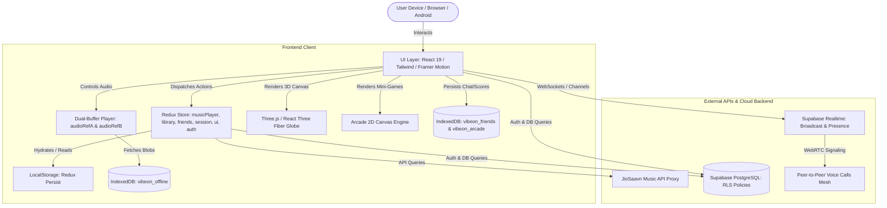
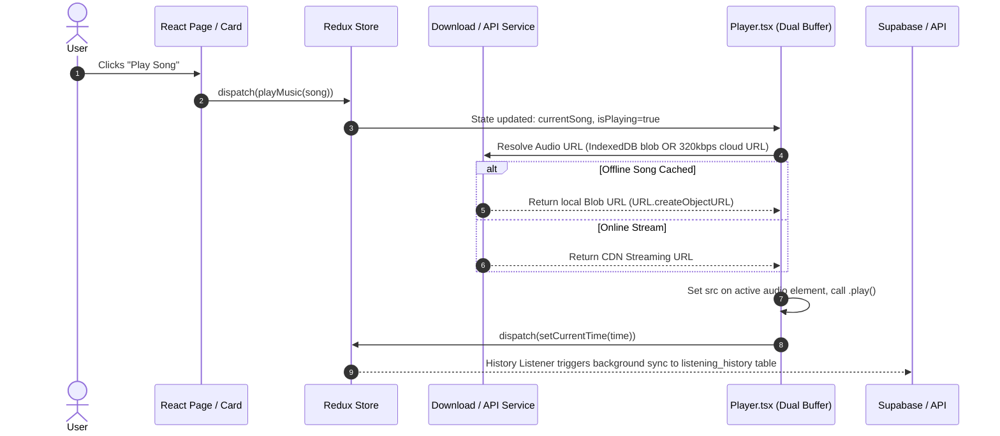
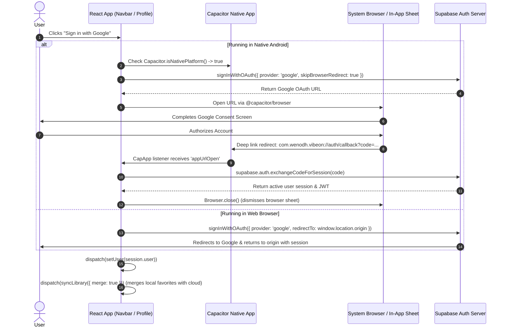
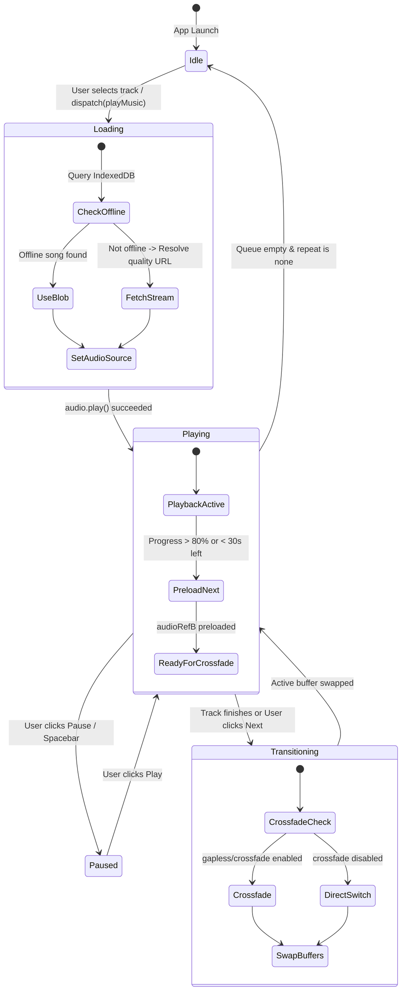
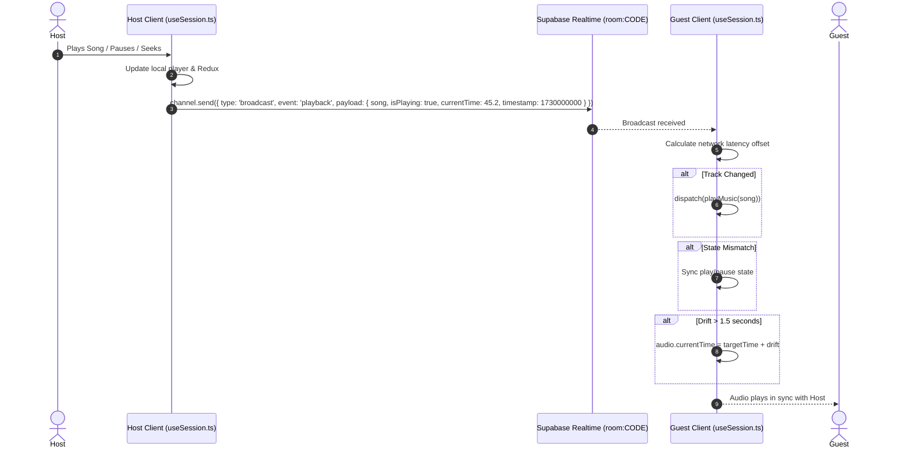
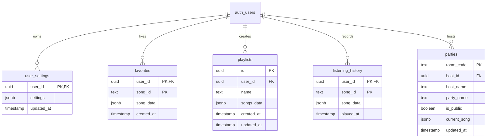

# Vibe On — Beginner-Friendly Project Architecture & Documentation Guide 🎧

> **Document Status**: Production Reference
> **Target Audience**: New developers, contributors, AI coding agents, and technical leads
> **Application Version**: 1.0.2 (Android versionCode: 6)
> **Source Verification Date**: November 2025

---

## 📑 Table of Contents

1. [Project Overview](#1-project-overview)
2. [Technology Stack](#2-technology-stack)
3. [Project Folder Structure](#3-project-folder-structure)
4. [Application Architecture](#4-application-architecture)
5. [Feature-by-Feature Documentation](#5-feature-by-feature-documentation)
6. [Music Playback Architecture](#6-music-playback-architecture)
7. [Group Listening / Party Session Architecture](#7-group-listening--party-session-architecture)
8. [Database Architecture](#8-database-architecture)
9. [State Management](#9-state-management)
10. [Supabase Integration](#10-supabase-integration)
11. [UI, Styling, and Responsive Design](#11-ui-styling-and-responsive-design)
12. [Performance and Optimization](#12-performance-and-optimization)
13. [Environment Setup and Local Development](#13-environment-setup-and-local-development)
14. [Common Development Workflows](#14-common-development-workflows)
15. [Security and Best Practices](#15-security-and-best-practices)
16. [Troubleshooting](#16-troubleshooting)
17. [Known Issues, Technical Debt, and Future Roadmap](#17-known-issues-technical-debt-and-future-roadmap)
18. [Guidelines for Future Developers and AI Agents (Rules Before Changing This Project)](#18-guidelines-for-future-developers-and-ai-agents)

---

## 1. Project Overview

### What is Vibe On?
**Vibe On** is an open, high-fidelity music streaming, library management, and social listening progressive web application (PWA) bundled for native Android deployment using **Capacitor**. It combines lossless-capable audio playback (up to 320kbps), time-synced animated lyrics, dynamic album artwork ambient lighting, an interactive 3D WebGL globe, retro mini-games that pulse to the rhythm of music, and peer-to-peer social collaboration (ephemeral group listening parties, 1-on-1 direct messaging, and ringing WebRTC audio calls).

### What Problem Does It Solve?
Most traditional music streaming platforms are proprietary, vendor-locked, ad-heavy, and lack cross-device synchronicity or user data ownership. Vibe On solves this by:
1. **Giving Users Ownership**: Providing zero-lock-in library portability (export/import in JSON, CSV, M3U8, TXT).
2. **True Offline Playback**: Storing full audio and artwork blobs locally in IndexedDB (`vibeon_offline`), completely decoupling local music playback from cloud network conditions.
3. **Frictionless Social Listening**: Enabling users to share room codes to listen in sync, react with floating emojis, message friends, and initiate P2P WebRTC audio calls without requiring phone numbers or intrusive accounts.
4. **Adaptive Aesthetics**: Infusing music listening with dynamic color extraction, glassmorphism, OLED battery optimization, and low-end hardware performance toggles.

### Who Are Its Intended Users?
* **Everyday Music Listeners**: Seeking a clean, beautiful, ad-free streaming player on web or Android.
* **Audiophiles**: Wanting a 10-band hardware-tuned equalizer, gapless preloading, and linear crossfading.
* **Friends & Communities**: Who want to enjoy listening sessions together across cities or play rhythm mini-games between tracks.
* **Offline Travelers**: Users who download playlists to listen without cellular data.

### High-Level Feature Summary

| Capability | Implementation Status | Storage / Technology |
|---|---|---|
| **Online Music Search & Streaming** | Fully Implemented | JioSaavn API Provider (`src/constants.ts`) |
| **Dual-Buffer Audio Engine** | Fully Implemented | 2x HTML5 `<audio>` elements (`Player.tsx`) |
| **Synced Lyrics** | Fully Implemented | LRC parser + smooth auto-scroll (`Lyrics.tsx`) |
| **Pro 10-Band Equalizer** | Fully Implemented | Web Audio API BiquadFilterNodes (`Equalizer.tsx`) |
| **Visualizers (5 Styles)** | Fully Implemented | HTML5 Canvas AnalyserNode (`Visualizer.tsx`) |
| **3D Interactive Globe** | Fully Implemented | Three.js + React Three Fiber (`SongGlobe.tsx`) |
| **Offline Downloads** | Fully Implemented | IndexedDB (`vibeon_offline` via `db.ts`) |
| **Direct Friends Chat & Calls** | Fully Implemented | Supabase Realtime + WebRTC + IndexedDB |
| **Group Listening Party** | Fully Implemented | Supabase Broadcast/Presence (`useSession.ts`) |
| **Vibe Arcade (3 Mini-Games)** | Fully Implemented | HTML5 Canvas 2D + Web Audio API SFX |
| **Library Import & Export** | Fully Implemented | JSON v1, CSV (BOM), M3U8, TXT (`src/lib/portability/`) |
| **Favorites Metadata Recovery** | Fully Implemented | Multi-endpoint failover repair tool (`RepairFavoritesModal.tsx`) |
| **OLED & Cyber Theming** | Fully Implemented | Tailwind CSS + CSS variables + ColorThief |

---

## 2. Technology Stack

Every technology listed below is verified in `package.json`, configuration files, and code imports:

### Frontend Core & Build Tooling
* **React 19.3.1 (`react`, `react-dom`)**: Modern React with concurrent rendering, lazy loading, and suspense wrappers.
* **TypeScript 5.9.3 (`typescript`)**: End-to-end static typing across components, Redux state, and external service contracts.
* **Vite 6.4.5 (`vite`, `@vitejs/plugin-react`)**: Ultra-fast ESM bundler with hot module replacement (HMR) and optimized chunk splitting.
* **React Router DOM 7.18.5 (`react-router-dom`)**: Declarative client-side routing, query parameter handling, and animated route transitions.

### State Management & Storage
* **Redux Toolkit 2.13.0 (`@reduxjs/toolkit`, `react-redux`)**: Centralized predictable state management with slice reducers, async thunks, and listener middleware.
* **Redux Persist 6.0.0 (`redux-persist`)**: Automatically persists client settings, auth tokens, player parameters, and library preferences in browser LocalStorage.
* **IndexedDB (`idb` & native `window.indexedDB`)**:
  * `vibeon_offline`: Stores binary audio and artwork blobs for zero-network playback (`src/utils/db.ts`).
  * `vibeon_friends`: Stores direct chat messages and friend rosters locally with zero database leak (`src/utils/friendsDb.ts`).
  * `vibeon_arcade`: Stores high scores and arcade settings (`src/features/arcade/services/arcadeStorage.ts`).

### Styling, UI & Micro-Interactions
* **Tailwind CSS 4.3.3 (`tailwindcss`, `@tailwindcss/vite`, `@tailwindcss/postcss`)**: Utility-first CSS styling compiled natively via PostCSS and Vite plugins.
* **Framer Motion 12.43.0 (`framer-motion`)**: Fluid layout animations (`layoutId="active-pill"`), presence transitions, swipe gestures, and reduced-motion fallback.
* **React Icons 5.7.0 (`react-icons`)**: Lightweight vector icons (IonIcons 5, Feather, Material Design).
* **ColorThief 3.5.0 (`colorthief`)**: Client-side dominant and palette color extraction from album artwork.

### 3D Graphics & Visualizations
* **Three.js 0.186.1 (`three`)**: WebGL rendering engine.
* **React Three Fiber 9.8.2 (`@react-three/fiber`)** & **Drei 10.7.9 (`@react-three/drei`)**: React component wrappers for the 3D interactive rotating music globe.

### Backend & Cloud Sync (Supabase)
* **`@supabase/supabase-js` 2.118.0**: Unified Supabase client for:
  * **Authentication**: Google OAuth sign-in with Android native deep-link exchange.
  * **PostgreSQL Database**: Relational tables (`user_settings`, `favorites`, `playlists`, `listening_history`, `parties`).
  * **Realtime**: WebSockets for channel broadcasting (`room:lobby`, `room:ROOM_CODE`, `user:USER_ID`), presence tracking, and WebRTC signaling.

### Native Mobile Platform (Android via Capacitor)
* **Capacitor 8.6.0 (`@capacitor/core`, `@capacitor/cli`, `@capacitor/android`, `@capacitor/app`, `@capacitor/browser`)**: Bridges web app into an Android APK, managing hardware back-button intercept, OS sleep timers, custom URL schemes (`com.wenodh.vibeon://auth/callback`), and system browser OAuth tabs.

### Testing & Quality Assurance
* **Vitest 3.2.7 (`vitest`)**: High-performance unit and integration testing suite configured with jsdom.
* **Playwright 1.64.1 (`@playwright/test`)**: End-to-end browser automation and responsive layout screenshot validation.
* **ESLint 9.39.5 (`eslint`)**: Static analysis with Flat Config (`eslint.config.js`).

---

## 3. Project Folder Structure

```
vibeon/
├── android/                   # Native Android Studio project (Capacitor v8 bridge)
│   ├── app/                   # Android App module, build.gradle, AndroidManifest.xml
│   ├── build.gradle           # Top-level Gradle configuration (AGP 8.9.1)
│   └── variables.gradle       # SDK versions (minSdk 24, compile/targetSdk 36)
├── docs/                      # Canonical documentation & database schemas
│   ├── DEVELOPER_GUIDE.md     # Deep technical reference for developers
│   ├── USER_GUIDE.md          # User-facing features and usage instructions
│   └── supabase_schema.sql    # PostgreSQL schema with Row-Level Security
├── public/                    # Static assets (PWA manifest, icons, robots.txt)
├── src/                       # Application source root
│   ├── assets/                # Local static images, SVGs, and fallbacks
│   ├── components/            # Reusable UI presentation components
│   │   ├── globe/             # Three.js 3D globe subcomponents
│   │   ├── modals/            # High-z-index overlays (Friends, Party, DownloadManager)
│   │   ├── session/           # Listening party chat and participant widgets
│   │   ├── toast/             # Global Toast notifications container
│   │   ├── Player.tsx         # Primary dual-buffer audio player engine
│   │   ├── MiniPlayer.tsx     # Floating picture-in-picture mini player
│   │   ├── MobileNowPlaying.tsx # Mobile full-screen expanded player overlay
│   │   ├── BottomBar.tsx      # Floating docked bottom navigation bar
│   │   ├── Navbar.tsx         # Top navigation bar with search and actions
│   │   └── SettingsDrawer.tsx # Glassmorphism drawer for themes, quality, audio
│   ├── constants/             # Navigation items, defaults, and API endpoints
│   ├── features/              # Redux domain slices (Redux Toolkit)
│   │   ├── arcade/            # Mini-games feature (Snake, Flappy Star, Vibe Runner)
│   │   ├── auth/              # Supabase authentication slice & OAuth actions
│   │   ├── friends/           # Direct 1-on-1 messaging & call state slice
│   │   ├── language/          # Language filter preferences slice
│   │   ├── library/           # Favorites, custom playlists & cloud sync slice
│   │   ├── musicplayer/       # Global playback engine state slice
│   │   ├── session/           # Real-time group listening party state slice
│   │   ├── settings/          # Supabase cloud settings sync middleware/actions
│   │   └── ui/                # Theme, font style, toasts, modals & drawer flags
│   ├── hooks/                 # Custom React hooks
│   │   ├── redux.ts           # Typed useDispatch and useSelector hooks
│   │   ├── useDirectCommunication.ts # Realtime 1-on-1 chat, seen ticks & WebRTC calls
│   │   ├── useFetchDetails.ts # Data fetching with AbortController cancellation
│   │   ├── useMasonryColumns.ts # Dynamic column layout calculation
│   │   └── useSession.ts      # Group listening party synchronization & WebRTC mesh
│   ├── lib/                   # External client instances & standalone libraries
│   │   ├── logger/            # Structured logging utility with levels
│   │   ├── portability/       # Library import/export engine (JSON, CSV, M3U8, TXT)
│   │   └── supabase.ts        # Initialized Supabase client instance
│   ├── pages/                 # Top-level route pages (Home, Explore, Library, etc.)
│   ├── services/              # Standalone business services
│   │   ├── downloadManager.ts # Concurrency-throttled offline download manager
│   │   ├── favoriteRecoveryService.ts # Incomplete favorites metadata repair service
│   │   └── partyService.ts    # Public party discovery & lobby broadcast manager
│   ├── types/                 # TypeScript interfaces and domain models
│   ├── utils/                 # General helpers (IndexedDB, ColorThief, LRC parsing)
│   ├── App.tsx                # App root: routing, native back button, auth listeners
│   ├── index.css              # Glassmorphism tokens, Tailwind utilities & animations
│   ├── main.tsx               # DOM mounting entry point
│   └── store.ts               # Redux store configuration, persist & listener middleware
├── capacitor.config.ts        # Capacitor app identification (`com.wenodh.vibeon`)
├── eslint.config.js           # ESLint Flat Config rules
├── package.json               # Dependencies, scripts, and project metadata
├── tailwind.config.js         # Tailwind theme extension & color palette tokens
└── vite.config.ts             # Vite configuration with PWA and React plugins
```

---

## 4. Application Architecture

Vibe On operates as a state-driven single-page application (SPA). Redux is the central source of truth for UI state, active playback, and local cached metadata. Supabase acts as the remote backend for persistence and real-time signaling.

### High-Level Architecture Diagram



### Frontend Data Flow Diagram



### Authentication Flow Diagram



---

## 5. Feature-by-Feature Documentation

### 5.1 Music Discovery & Search
* **Status**: Fully Implemented.
* **Access**: Top navigation bar (`/search`), Explore page (`/explore`), Home page (`/`).
* **Components**: `src/pages/Search.tsx`, `src/pages/Explore.tsx`, `src/components/SearchSection.tsx`, `src/components/ExploreSongCard.tsx`.
* **Data Flow**:
  1. User types in search bar -> 300ms debounced input triggers API query via Axios to `${url}/api/search?query=...`.
  2. Search handles songs, albums, and playlists.
  3. AbortController cancels outstanding requests when the query changes to prevent stale UI flashes.
* **Limitations**: Search relies on JioSaavn public API proxies. Rate limits or upstream proxy downtime can cause fallback skeletons to display.

### 5.2 Music Playback Engine
* **Status**: Fully Implemented.
* **Access**: Bottom playback pill (`Player.tsx`), mini-player (`MiniPlayer.tsx`), and mobile full-screen modal (`MobileNowPlaying.tsx`).
* **Components**: `src/components/Player.tsx`, `src/components/MiniPlayer.tsx`, `src/components/MobileNowPlaying.tsx`.
* **State Management**: `src/features/musicplayer/musicPlayerSlice.ts`.
* **Capabilities**: Dual-buffer gapless preloading, linear crossfade (1s-10s), repeat (none/all/one), shuffle, sleep timer, seek scrub, dynamic volume control.

### 5.3 10-Band Equalizer & Visualizers
* **Status**: Fully Implemented.
* **Access**: Player options menu -> Equalizer / Visualizer.
* **Components**: `src/components/Equalizer.tsx`, `src/components/Visualizer.tsx`.
* **Web Audio Routing**:
  ```
  HTMLAudioElement -> MediaElementAudioSourceNode -> 10x BiquadFilterNodes -> AnalyserNode -> AudioDestinationNode
  ```
* **Visualizer Modes**: 5 canvas-rendered styles: `bars`, `waveform`, `particles`, `circular`, `pixel`.
* **Equalizer Bands**: 32Hz, 64Hz, 125Hz, 250Hz, 500Hz, 1kHz, 2kHz, 4kHz, 8kHz, 16kHz with presets (Bass Boost, Vocal, Electronic, Rock, Classical).

### 5.4 Offline Downloads & Storage Manager
* **Status**: Fully Implemented.
* **Access**: Song 3-dots menu -> "Download Song", Profile -> "Downloads", Bulk download modal on playlists/albums.
* **Services**: `src/services/downloadManager.ts`, `src/utils/db.ts`.
* **Architecture**: Configurable bounded concurrency queue (default 3, user-selectable options: 1, 2, 3, 5, 10, 30, 60, or 100 simultaneous downloads), Wi-Fi only restriction option, quality preference resolution, IndexedDB binary storage (`audioBlob`, `imageBlob`).
* **Data Isolation**: Deleting local offline downloads only removes IndexedDB blobs and never removes cloud favorites.

### 5.5 Time-Synced Synced Lyrics
* **Status**: Fully Implemented.
* **Access**: Tap Lyrics icon in the Player or MobileNowPlaying view.
* **Components**: `src/components/Lyrics.tsx`, `src/utils/lrcParser.ts`.
* **Capabilities**: Fetches `.lrc` formatted string or synced lyric array from API. Parses timestamps into millisecond markers. Auto-scrolls actively highlighted lyric lines in real-time. Tapping any line seeks playback directly to that timestamp.

### 5.6 3D Interactive Song Globe
* **Status**: Fully Implemented.
* **Access**: Route `/globe` or BottomBar Globe icon.
* **Components**: `src/pages/SongGlobe.tsx`, `src/components/globe/GlobeScene.tsx`.
* **Stack**: Three.js + React Three Fiber + Drei.
* **Features**: Interactive rotating 3D Earth rendered in WebGL. Pinpoints global music hubs (Tokyo, London, Mumbai, New York, Lagos, etc.). Clicking a pin displays localized trending tracks with one-tap playback.

### 5.7 Vibe Arcade Mini-Games
* **Status**: Fully Implemented.
* **Access**: Route `/arcade` and `/arcade/:gameId`.
* **Components**:
  * `src/features/arcade/pages/ArcadeHome.tsx`
  * `src/features/arcade/pages/ArcadeGameView.tsx`
  * `src/features/arcade/games/snake/SingerSnakeGame.tsx`
  * `src/features/arcade/games/flappy-bird/FlappyStarGame.tsx`
  * `src/features/arcade/games/dino-runner/VibeRunnerGame.tsx`
* **Features**:
  * **Singer Snake**: Classic snake game collecting music notes.
  * **Flappy Star**: Flappy bird mechanic featuring a photo-powered circular portrait of the currently playing song's artist with velocity tilt physics, gentle floaty gravity (0.22), wide passage gaps (205px), and touch-friendly controls.
  * **Vibe Runner**: Side-scroller jumping over speakers and amplifiers.
  * **Engines**: `SongThemeEngine` (adapts game colors to active album art), `DialogueEngine` (Telugu, Hindi, English quips), Web Audio API sound synthesis (SFX muted by default), and IndexedDB score persistence (`vibeon_arcade`).

### 5.8 Direct Friends Chat & P2P WebRTC Calls
* **Status**: Fully Implemented.
* **Access**: Quick Actions in Settings Drawer or BottomBar Friends icon -> Opens `FriendsModal.tsx`.
* **Hooks & Slices**: `src/hooks/useDirectCommunication.ts`, `src/features/friends/friendsSlice.ts`, `src/utils/friendsDb.ts`.
* **Capabilities**:
  * **Anonymous User Codes**: Auto-generated 6-character user codes persisted in LocalStorage (`vibeon_user_code`). Adding a code pairs two devices as friends.
  * **Zero Server Storage**: Direct messages are stored strictly in the recipient's and sender's local IndexedDB (`vibeon_friends`). Messages travel ephemerally through Supabase Realtime personal channels (`user:USER_ID`).
  * **Message Read Receipts**: Status progression from `sending` -> `sent` (single tick ✓) -> `delivered` (double grey ticks ✓✓) -> `seen` (double cyan ticks ✓✓) triggered by Realtime acknowledgment events (`message_ack`, `message_seen`).
  * **Direct WebRTC Voice Calls**: Ringing incoming call modal (`IncomingCallModal.tsx`) with accept/reject buttons. Full-screen mobile active call overlay with live duration timer, mute toggle, and peer connection state tracking.

### 5.9 Group Listening Party / Session
* **Status**: Fully Implemented.
* **Access**: Quick Actions in Settings Drawer -> "Listening Party" -> Opens `SessionModal.tsx`.
* **Hooks & Services**: `src/hooks/useSession.ts`, `src/features/session/sessionSlice.ts`, `src/services/partyService.ts`.
* **Capabilities**:
  * Host creates a room with an auto-generated 6-character alphanumeric code or joins via code.
  * Public party discovery tab (`Discover Parties`) with Realtime lobby broadcast fallback (`room:lobby`).
  * Host synchronizes play, pause, seek, and track changes to all connected guests.
  * Ephemeral room chat with zero database persistence.
  * Floating real-time emoji reactions.
  * Integrated multi-peer WebRTC mesh voice calling.
  * Full-screen mobile layout (`h-[100dvh]`) with adaptive light/dark theme contrast.

### 5.10 Music Library Portability (Import & Export)
* **Status**: Fully Implemented.
* **Access**: Settings Drawer -> "Backup & Restore" or Library toolbar.
* **Files**: `src/lib/portability/` (`orchestrator.ts`, `matching.ts`, `schema.ts`, parsers, exporters).
* **Supported Formats**: JSON v1 (`vibeon-library`), CSV (RFC 4180 with UTF-8 BOM), M3U/M3U8 playlists (`#EXTM3U`), and plain text.
* **Safety**: Defaults strictly to non-destructive Merge mode. Destructive Replace mode is disabled to protect cloud databases. Includes 4-tier track matching and manual conflict resolution search.

### 5.11 Favorite Metadata Recovery
* **Status**: Fully Implemented.
* **Access**: Profile page quick action -> "Repair Favorites" -> Opens `RepairFavoritesModal.tsx`.
* **Service**: `src/services/favoriteRecoveryService.ts`.
* **Purpose**: Scans user favorites for incomplete metadata (e.g. broken titles, missing album art, missing stream URLs), tests failover endpoints, executes dry-run previews, updates Supabase rows, and updates local cache checkpoints in LocalStorage.

---

## 6. Music Playback Architecture

### How Audio is Resolved and Played
The playback engine resides in `src/components/Player.tsx` and is governed by `src/features/musicplayer/musicPlayerSlice.ts`.

1. **Resolution Pipeline**:
   * When `playMusic(song)` is dispatched, `formatSong` selects the stream URL matching the user's `preferredQuality` (e.g., 320kbps, 160kbps, 96kbps).
   * Before streaming over the network, `Player.tsx` queries IndexedDB (`getOfflineSong(song.id)`). If an offline blob exists, it instantiates an object URL via `URL.createObjectURL(song.audioBlob)` to play locally with zero network bandwidth.
2. **Dual-Buffer System**:
   * Two persistent HTML5 audio elements (`audioRefA` and `audioRefB`) are maintained.
   * While `audioRefA` is playing the active track, the next song in the queue is preloaded onto `audioRefB` when playback crosses 80% duration or has less than 30 seconds remaining.
   * During track changes, a linear gain crossfade ramps down the retiring audio element while ramping up the incoming audio element over `crossfadeDuration` seconds (1s to 10s).
3. **Controls & Audio Lifecycle**:
   * **Seek**: Updates `currentTime` on the active audio element and synchronizes Redux state.
   * **Repeat Mode**: `none` (advances to next song), `all` (loops playlist), `one` (sets `audio.loop = true`).
   * **Shuffle**: Re-indexes queue order using deterministic shuffle without mutating original playlist array.
   * **MediaSession Integration**: Synchronizes metadata (title, artist, album, artwork variants) with OS system notifications and lock screens, binding play, pause, seek, previoustrack, and nexttrack handlers.

### Complete Playback Lifecycle Diagram



---

## 7. Group Listening / Party Session Architecture

The group listening party architecture allows a host to broadcast their playback state and media decisions to an unlimited number of guests in real-time, accompanied by ephemeral chat, reaction overlays, and WebRTC voice calling.

### Roles and Capabilities
* **Host**: Creates the room code, controls play/pause, seeks, changes tracks, selects public/private visibility, and manages participant permissions.
* **Guest**: Enters room code or clicks a public party card, automatically mirrors host playback state, sends chat messages, and emits floating emoji reactions.

### Party Discovery & Lobby Channels
1. **Database + Lobby Fallback**:
   * `src/services/partyService.ts` attempts to upsert active parties into the Supabase `parties` table.
   * If the `parties` table has not been created or lacks permissions, it gracefully falls back to broadcasting presence and party announcements across a dedicated Supabase Realtime channel named `room:lobby`.
2. **Channel Protocol (`room:ROOM_CODE`)**:
   * **Event `playback`**: Emitted by Host containing `{ song, isPlaying, currentTime, timestamp }`. Guests calculate latency drift and seek if local offset exceeds 1.5 seconds.
   * **Event `chat`**: Ephemeral message payload `{ id, user, text, timestamp }`. Stored in memory in `sessionSlice.ts`; never saved to disk.
   * **Event `reaction`**: Floating emoji payload `{ id, emoji, senderName }`. Triggers CSS particle animations on all connected clients.
   * **Events `offer`, `answer`, `ice-candidate`**: WebRTC signaling payloads facilitating peer-to-peer audio calling mesh.

### Host-to-Guest Playback Synchronization Diagram



---

## 8. Database Architecture

Vibe On uses a PostgreSQL database hosted on Supabase, protected by Row-Level Security (RLS) policies.

### Entity Relationship (ER) Diagram



### Table Specifications & Security Policies

#### 1. `public.user_settings`
* **Purpose**: Stores consolidated client settings, audio preferences, theme colors, font styles, and mobile navigation items.
* **Columns**: `user_id` (UUID, PK), `settings` (JSONB, default `{}`), `updated_at` (TIMESTAMPTZ).
* **RLS**: Enabled. Users can only SELECT, INSERT, UPDATE, and DELETE rows where `auth.uid() = user_id`.

#### 2. `public.favorites`
* **Purpose**: Stores liked tracks synchronized across user devices.
* **Columns**: `user_id` (UUID, PK), `song_id` (TEXT, PK), `song_data` (JSONB), `created_at` (TIMESTAMPTZ).
* **RLS**: Enabled. Strictly owner-only access (`auth.uid() = user_id`).

#### 3. `public.playlists`
* **Purpose**: Stores custom user-created playlists and their ordered song arrays.
* **Columns**: `id` (UUID, PK), `user_id` (UUID, FK), `name` (TEXT), `songs_data` (JSONB, default `[]`), `created_at` (TIMESTAMPTZ), `updated_at` (TIMESTAMPTZ).
* **RLS**: Enabled. Strictly owner-only access (`auth.uid() = user_id`).

#### 4. `public.listening_history`
* **Purpose**: Tracks recently played songs for user profile history and daily mix recommendations.
* **Columns**: `user_id` (UUID, PK), `song_id` (TEXT, PK), `song_data` (JSONB), `played_at` (TIMESTAMPTZ).
* **RLS**: Enabled. Owner-only access (`auth.uid() = user_id`). Deduplicated and locked to the latest 20 items.

#### 5. `public.parties` (Optional / Dynamic)
* **Purpose**: Stores discoverable public listening parties.
* **Fallback**: When the table is absent in self-hosted Supabase instances, `partyService.ts` transparently operates using ephemeral Realtime broadcast channels (`room:lobby`).

---

## 9. State Management

Global state is managed via **Redux Toolkit** in `src/store.ts`.

### Redux Slices Overview

| Slice | File Path | Responsibilities | Persistence |
|---|---|---|---|
| **`musicPlayer`** | `src/features/musicplayer/musicPlayerSlice.ts` | Active song, playback state, queue, volume, repeat, shuffle, equalizer, crossfade | LocalStorage (`redux-persist`) |
| **`library`** | `src/features/library/librarySlice.ts` | Favorites list, user playlists, downloaded IDs, cloud sync flags | LocalStorage (`redux-persist`) |
| **`ui`** | `src/features/ui/uiSlice.ts` | Dark mode, OLED mode, accent color, font style, toasts, drawer & modal visibility | LocalStorage (`redux-persist`) |
| **`auth`** | `src/features/auth/authSlice.ts` | Active Supabase user object, session token, profile details | LocalStorage (`redux-persist`) |
| **`session`** | `src/features/session/sessionSlice.ts` | Room code, isHost, participant roster, chat messages, public parties | Room code & isJoined |
| **`friends`** | `src/features/friends/friendsSlice.ts` | Active friend chat, peer connection state, unread counts, active call details | Ephemeral (history in IndexedDB) |
| **`language`** | `src/features/language/languageSlice.ts` | Active language selection filters for home/explore feeds | LocalStorage (`redux-persist`) |

### Redux Listener Middleware Architecture
`src/store.ts` configures automated listener middlewares:
1. **`settingsListener`**: Intercepts actions such as `setAccentColor`, `setDarkMode`, `setPreferredQuality`, and `setEqualizerBand`. It updates local timestamps (`settingsUpdatedAt`), debounces for 1,000ms, and dispatches `uploadSettings()` to persist changes to Supabase without manual save buttons.
2. **`historyListener`**: Intercepts `playMusic` dispatches, delays 100ms, and automatically uploads the track to the `listening_history` Supabase table in the background if the user is authenticated.

---

## 10. Supabase Integration

### Client Initialization
Located in `src/lib/supabase.ts`:
```typescript
import { createClient } from '@supabase/supabase-js';

const supabaseUrl = import.meta.env.VITE_SUPABASE_URL;
const supabaseAnonKey = import.meta.env.VITE_SUPABASE_ANON_KEY;

export const supabase = createClient(
    supabaseUrl || 'https://placeholder.supabase.co',
    supabaseAnonKey || 'placeholder'
);
```
* If environment variables are missing, the client initializes with fallback placeholders and logs warning messages to prevent runtime application crashes.

### Realtime Channels & Lifecycles
Channels are instantiated via `supabase.channel(topic)`. To prevent resource leaks:
* Duplicate channels are pruned by checking `supabase.getChannels()` before creating new ones.
* Channels explicitly call `supabase.removeChannel(channel)` when components unmount.
* Stale channels matching `room:` prefixes are cleaned up before joining new sessions.

---

## 11. UI, Styling, and Responsive Design

### Design System Tokens
* **Typography**: Primary body text is set to `Plus Jakarta Sans`. Headings and display labels use `Outfit`. Cursive options (Courgette, Lobster, Dancing Script) can be applied application-wide via settings.
* **Glassmorphism Utilities** (`src/index.css`):
  * `.glass`: Translucent backdrop blur panel (`backdrop-blur-xl bg-white/10 dark:bg-black/30 border border-white/10`).
  * `.glass-card`: Elevated card container with hover transitions.
  * `.glow-box`: Ambient glow filter reflecting the user's selected accent color.
* **Color Palette Tokens**:
  * `cyber-violet` (`#8b5cf6`), `cyber-cyan` (`#06b6d4`), `cyber-emerald` (`#10b981`), `cyber-rose` (`#f43f5e`), `cyber-amber` (`#f59e0b`).
  * Pure OLED Black (`#000000`) applied via `.oled-mode` for battery savings on mobile displays.

### Responsive Layout & Viewport Hierarchy
* **Mobile Viewports (320px – 768px)**:
  * Overlays (`FriendsModal`, `IncomingCallModal`, `SessionModal`, `MobileNowPlaying`) take **100% full screen** (`h-[100dvh]`, `rounded-none`, edge-to-edge).
  * Safe-area insets (`env(safe-area-inset-top)` and `env(safe-area-inset-bottom)`) are respected to prevent notch and home-indicator collisions.
  * Bottom navigation (`BottomBar.tsx`) renders as a floating docked bar with dynamic padding.
* **Desktop Viewports (769px+)**:
  * Overlays render as centered glassmorphic modals with fixed maximum widths (`max-w-xl`, `max-w-4xl`) and rounded corners.
  * Top navigation header (`Navbar.tsx`) displays direct navigation links, search input, and profile controls.

### Z-Index Hierarchy Standard
To eliminate overlay stacking collisions:
* **Toasts (`ToastContainer`)**: `z-[9999]`
* **Modals & Overlays (`FriendsModal`, `SessionModal`, `IncomingCallModal`)**: `z-[500]`
* **Full-Screen Arcade View**: `z-[400]`
* **Bottom Bar Navigation (`BottomBar.tsx`)**: `z-[350]`
* **Drawers & Sidebars (`SettingsDrawer`, `Queue`)**: `z-[300]` / `z-[310]`
* **Player Pill (`Player.tsx`)**: `z-[210]`
* **Main Content Layout**: `z-[10]`

---

## 12. Performance and Optimization

### Existing Verified Optimizations
1. **Network Request Cancellation**: All search and detail fetching hooks (`Navbar.tsx`, `Explore.tsx`, `SongGlobe.tsx`, `useFetchDetails.ts`) bind an `AbortController`. Outstanding network calls are immediately aborted when queries or tabs change, suppressing unmounted component memory leaks.
2. **Component Memoization**: Media item components (`SongItem.tsx`, `AlbumItem.tsx`) are wrapped in `React.memo` and subscribe to fine-grained primitive Redux selectors (e.g., `state.musicPlayer.currentSong?.id`) to prevent re-rendering when playback progress ticks.
3. **Dual-Buffer Audio Preloading**: Preloading the next queue item at 80% progress prevents playback stalls on mobile networks.
4. **Low-End Hardware Optimization**: The `disableAnimations` setting in `uiSlice.ts` activates Framer Motion's `reducedMotion="always"` and applies `html.disable-animations` to disable GPU-heavy CSS blurs and keyframe animations.
5. **Route Code Splitting**: All pages and heavy modals are wrapped in `React.lazy()` and loaded on demand inside `React.Suspense` boundaries with glassmorphism skeleton fallbacks.

### Recommended Future Improvements
* **Virtualization**: Implement `@tanstack/react-virtual` for queues and playlists exceeding 500 tracks to avoid large DOM tree sizes.
* **Web Workers for LRC Parsing**: Move large lyric parsing and multi-track library matching algorithms onto dedicated Web Workers.

---

## 13. Environment Setup and Local Development

### Prerequisites
* **Node.js**: `v22.0.0` or higher (verified in `package.json` engines).
* **npm**: `v10.0.0` or higher.
* **JDK**: OpenJDK 21 (required for native Android builds).
* **Android Studio**: Ladybug / Meerkat with Android SDK Platform 36 (Android 16).

### Step-by-Step Local Setup

1. **Clone Repository & Install Dependencies**:
   ```bash
   git clone https://github.com/your-username/vibeon.git
   cd vibeon
   npm install
   ```

2. **Configure Environment Variables**:
   Create a `.env` file in the project root:
   ```env
   # Supabase Configuration (Required for cloud sync, auth, and realtime sessions)
   VITE_SUPABASE_URL=https://your-project.supabase.co
   VITE_SUPABASE_ANON_KEY=your-anon-key-here
   ```

3. **Start Local Development Server**:
   ```bash
   npm run dev
   ```
   Open `http://localhost:5173` in your browser.

4. **Execute Tests**:
   ```bash
   npm test
   ```

5. **Lint Codebase**:
   ```bash
   npm run lint
   ```

6. **Build Web Production Assets**:
   ```bash
   npm run build
   ```

7. **Synchronize & Build Android APK (Capacitor)**:
   ```bash
   npx cap sync android
   cd android
   ./gradlew assembleDebug
   ```
   The compiled debug APK will be located at `android/app/build/outputs/apk/debug/app-debug.apk`.

---

## 14. Common Development Workflows

### 1. Adding a New Page Route
1. Create the page component in `src/pages/MyNewPage.tsx`.
2. Wrap content in `<PageWrapper>` with standard glassmorphic containers.
3. Open `src/App.tsx`:
   * Add a lazy import: `const MyNewPage = lazy(() => import('./pages/MyNewPage'));`
   * Register the route inside `<AnimatedRoutes>`:
     ```tsx
     <Route
         path="/my-new-page"
         element={
             <Suspense fallback={<CardSkeleton />}>
                 <PageWrapper><MyNewPage /></PageWrapper>
             </Suspense>
         }
     />
     ```

### 2. Adding a New Navigation Item
1. Open `src/constants/navigation.ts`.
2. Add a new entry to `ALL_MOBILE_NAV_ITEMS` with unique `id`, `label`, `path`, and React Icons.
3. If it should appear by default, append its `id` to `DEFAULT_VISIBLE_NAV_IDS`.
4. Ensure route handling or modal trigger logic is configured in `BottomBar.tsx`.

### 3. Adding a New Setting
1. Add the property to `uiSlice.ts` or `musicPlayerSlice.ts` initial state and create a corresponding reducer action.
2. If the setting must sync to the cloud, append the action creator to `settingsListener.startListening({ matcher: isAnyOf(...) })` in `src/store.ts`.
3. Add the control toggle or dropdown inside `src/components/SettingsDrawer.tsx`.

### 4. Adding a New Realtime Event
1. Open `src/hooks/useSession.ts` (for parties) or `src/hooks/useDirectCommunication.ts` (for friends).
2. Register the event listener on the Supabase channel:
   ```typescript
   channel.on('broadcast', { event: 'my_custom_event' }, ({ payload }) => {
       // Dispatch Redux action or update local state
   });
   ```
3. Expose a sender function that invokes:
   ```typescript
   channel.send({ type: 'broadcast', event: 'my_custom_event', payload: data });
   ```

---

## 15. Security and Best Practices

### Essential Security Rules
1. **Never Expose Private Keys**: Keep the `SUPABASE_SERVICE_ROLE_KEY` strictly out of frontend code. Only `VITE_SUPABASE_ANON_KEY` is permitted in client configurations.
2. **Row-Level Security (RLS) is Mandatory**: Every new PostgreSQL table must execute `ALTER TABLE table_name ENABLE ROW LEVEL SECURITY;` and enforce `auth.uid() = user_id` across `SELECT`, `INSERT`, `UPDATE`, and `DELETE`.
3. **Sanitize HTML in User Inputs**: Use `decodeHtml` or text node assignments when rendering song titles, artist names, or chat messages to prevent cross-site scripting (XSS).
4. **Clean Up Realtime Channels**: Always call `supabase.removeChannel(channel)` in React `useEffect` cleanup return functions to prevent dangling WebSocket connections.
5. **IndexedDB Privacy**: Direct friends chat messages must remain strictly in local IndexedDB (`vibeon_friends`). Never transmit private friend chat messages to public database tables.

---

## 16. Troubleshooting

| Symptom | Probable Cause | Verified Solution |
|---|---|---|
| **Audio fails to play or stays paused** | Stale audio URL or browser autoplay block | Click the play button directly (user gesture required). Check `preferredQuality` in Settings. If offline, confirm song is downloaded in Library. |
| **Google Sign-In fails on Android** | SHA-1 fingerprint mismatch in Google Cloud | Run `cd android && ./gradlew signingReport`. Copy debug SHA-1 into Google Cloud Console OAuth Client and Supabase Dashboard Auth settings. |
| **Android back button exits immediately** | Native back listener unmounted or overlays open | Ensure `App.tsx` has registered `CapApp.addListener('backButton')`. The listener closes open overlays before navigating back or exiting. |
| **Direct message shows single tick only** | Recipient device is offline or channel not subscribed | Double ticks (delivered/seen) require the recipient's device to be online and listening on its personal channel `user:USER_ID`. |
| **Supabase environment warnings in console** | Missing `.env` values | Ensure `VITE_SUPABASE_URL` and `VITE_SUPABASE_ANON_KEY` exist in `.env` and restart Vite server. |
| **Build fails with AGP version errors** | Android Gradle Plugin mismatch | Check `android/build.gradle`. Ensure AGP version is set to `8.9.1` and compiled with Gradle `8.14.3` and JDK 21. |

---

## 17. Known Issues, Technical Debt, and Future Roadmap

### Implemented vs. Planned Architectural Baseline
* **Implemented**: Dual-buffer player in `Player.tsx`, client-side IndexedDB storage (`db.ts`, `friendsDb.ts`), JioSaavn provider integration, and direct Supabase client sync.
* **Planned (Future Concepts)**:
  * Modular `AudioSDK` with standard plug-and-play provider adapters (LibriVox, Radio-Browser, Podcast Index).
  * Centralized `PlaybackManager` singleton orchestrating native vs HLS audio engines.
  * Offline-first operational sync log (`SyncManager`) for automated conflict resolution.
  * Structured multi-tenant podcast and audiobook bookmark management.

### Technical Debt & Code Cleanup Opportunities
1. **`Player.tsx` Refactoring**: `Player.tsx` is currently large (~68KB) and handles audio element refs, MediaSession, Web Audio API context, UI pill interactions, and gesture scrubbing. Extracting audio engine mechanics into a custom hook (`useAudioEngine`) is recommended for future refactoring.
2. **Library Page Re-renders**: `src/pages/Library.tsx` contains multiple inline any typings that should be migrated to strictly typed interfaces in `src/types/music.ts`.

---

## 18. Guidelines for Future Developers and AI Agents

### Rules Before Changing This Project ⚠️

1. **Inspect Existing Implementations First**: Never assume a utility or hook does not exist. Inspect `src/utils/`, `src/hooks/`, `src/services/`, and `src/components/` before creating new abstractions.
2. **Preserve the Dual-Buffer Player Contract**: Do not alter `audioRefA` and `audioRefB` buffer mechanics or bypass Redux `musicPlayerSlice` when modifying audio features.
3. **Respect Mobile Full-Screen Standard**: All mobile modals and overlays must render edge-to-edge (`h-[100dvh]`, `rounded-none`, with safe-area insets) on viewports below 768px.
4. **Maintain Android SDK Compatibility**: Android builds target SDK 36 (Android 16) with minimum SDK 24. Do not downgrade compile/target SDK versions without project lead approval.
5. **Never Commit Secrets**: Do not write real Supabase secret keys, Google OAuth client secrets, or keystore passwords into code or documentation.
6. **Keep Canonical Docs Synchronized**: When altering architecture, database schemas, or user workflows, you must update this document (`PROJECT_GUIDE.md`), `AGENTS.md`, `docs/DEVELOPER_GUIDE.md`, and `docs/USER_GUIDE.md`.
7. **Verify Before Submitting**: Always execute `npm run build`, `npm run lint`, and `npm test` before pushing changes.
