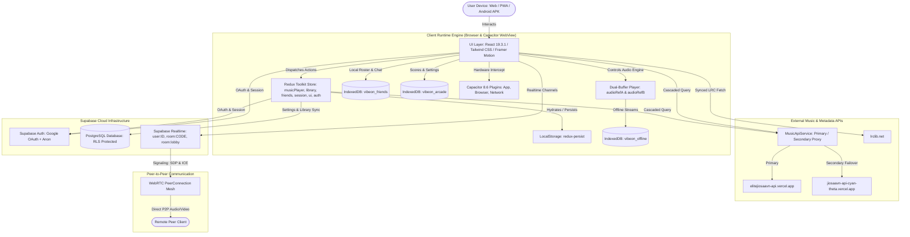
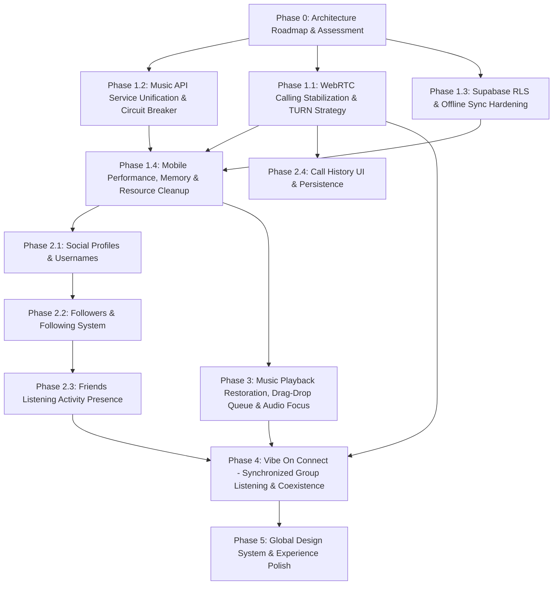

# Vibe On — Comprehensive Product Roadmap & Architectural Assessment 🚀

> **Document Status**: Production Architecture & Engineering Assessment
> **Application Version**: 1.0.2 (Android versionCode: 6)
> **Target Audience**: Product Engineering, Technical Leadership, AI Autonomous Agents
> **Date**: November 2026
> **Immediate Scope**: Phase 0 Complete — Awaiting Approval Before Phase 1 Execution

---

## Executive Summary

**Vibe On** is an ambitious, modern music streaming progressive web application (PWA) packaged for native Android via **Capacitor 8.6**. It combines rich client-side audio playback (dual-buffer gapless engine, 10-band hardware-tuned equalizer, canvas visualizers), offline persistence (IndexedDB for raw audio and artwork blobs), real-time peer-to-peer and group collaboration (Supabase Realtime, WebRTC audio/video mesh, ephemeral chat), library portability, and retro rhythm mini-games.

However, an honest code-level audit demonstrates that Vibe On currently exhibits a gap between its **presentation layer** (UI surfaces, modals, and design tokens) and its **production-hardened runtime layer**:
1. **Calling & WebRTC**: The UI for audio/video calling is complete (`ActiveCallModal`, `IncomingCallModal`, `ActiveCallBar`), but the signaling hook (`useDirectCommunication.ts`) relies exclusively on Google's public STUN servers without TURN traversal. Video streaming tracks are not negotiated in `getUserMedia`, camera flip/device switching handlers are missing from the hook return contract, and incoming call handling across disparate anonymous/authenticated sessions lacks persistence and network reconnection handling.
2. **Music API Resilience**: `MusicApiService` cascades between primary (`elitejiosaavn-api`) and secondary (`jiosaavn-api-cyan-theta`) proxies with client-side caching. However, multiple views (`Navbar.tsx`, `PageTemplate.tsx`, `DailyMix.tsx`, `Explore.tsx`, `SongGlobe.tsx`) bypass `MusicApiService` and issue direct `axios.get` calls using static endpoints from `src/constants.ts`, undermining unified fallback, timeout, and circuit breaker protection.
3. **Audiobook & Radio Providers**: LibriVox and Radio Browser are not active production providers. They exist purely as experimental references in `favoriteRecoveryService.ts` and documentation descriptions. JioSaavn remains the sole functional music provider.
4. **Data Isolation & Security**: Supabase RLS policies protect existing tables (`favorites`, `playlists`, `user_settings`, `listening_history`), but new social features (profiles, follow relationships, shared playlists, call history) currently lack dedicated database tables and secure RLS definitions.

This document presents the canonical roadmap to stabilize Vibe On into a resilient, scalable, world-class music and social platform without regressing existing features or incurring destructive database migrations.

---

## 1. Current Application Architecture

Vibe On is structured as a client-orchestrated Single Page Application (SPA) with cloud synchronization and native mobile bindings:



### 1.1 State Management Architecture
* **Store Configuration (`src/store.ts`)**: Redux Toolkit with `redux-persist` persisting `musicPlayer`, `library`, `ui`, `auth`, `session`, and `language` slices into `localStorage`.
* **Listener Middleware**:
  * `settingsListener`: Intercepts theme, audio quality, and equalizer updates; increments `settingsUpdatedAt`; debounces by 1,000ms; and invokes `uploadSettings()` to persist JSON payloads to the `user_settings` table.
  * `historyListener`: Intercepts `playMusic` actions and asynchronously records tracks into `listening_history` (locked to latest 20 items).
* **Data Flow**: Unidirectional. UI components subscribe to atomic slices via typed hooks (`useAppSelector`, `useAppDispatch`).

### 1.2 Audio Engine Architecture (`src/components/Player.tsx`)
* **Dual-Buffer Mechanism**: Maintains two persistent HTML5 `<audio>` elements (`audioRefA` and `audioRefB`).
* **Gapless Preloading**: When the current track reaches >80% playback progress or <30 seconds remaining, the upcoming queue item is resolved and preloaded into the inactive audio element.
* **Linear Crossfade**: Smoothly transitions between buffers across a user-configurable duration (1s–10s) using Web Audio API gain nodes or incremental volume attenuation.
* **Storage Resolution**: Prioritizes local IndexedDB audio blobs (`vibeon_offline`) before requesting remote CDN audio streams.

### 1.3 WebRTC Calling Architecture (`src/hooks/useDirectCommunication.ts`)
* **Signaling Transport**: Supabase Realtime personal channels (`user:<userId>`) exchange ephemeral broadcast events: `direct_signal` (`call-request`, `call-accepted`, `call-declined`, `call-ended`, `offer`, `answer`, `ice-candidate`).
* **Audio Routing**: Handled via `persistentAudioManager.ts` (singleton DOM audio element surviving React unmounts) to mitigate autoplay browser restrictions.
* **State Management**: Centralized in `friendsSlice.ts` (`activeCall`, `incomingCall`, `isCallActive`, `isCallScreenExpanded`).

### 1.4 Native Platform Integration (`Capacitor 8.6.0`)
* **Hardware Back Button**: Centralized in `src/App.tsx`. Evaluates an internal route history stack (`historyStackRef`) and active overlay hierarchy (closing topmost modals first: playlist -> session -> equalizer -> lyrics -> queue -> settings -> expanded player -> route back -> `App.exitApp()`).
* **OAuth Callback**: Captures custom deep-link scheme `com.wenodh.vibeon://auth/callback` via `App.addListener('appUrlOpen')`, exchanges authorization code for JWT session via `supabase.auth.exchangeCodeForSession(code)`, and dismisses the in-app browser sheet via `Browser.close()`.

---

## 2. Existing Features and Implementation Status

The table below reflects an audit of the physical code in `src/`, distinguishing **Implemented**, **Partially Implemented**, **Planned**, **Mocked**, and **Unverified** functionality:

| Feature / Domain | Code Location | Status | Implementation Details & Gaps |
|---|---|---|---|
| **Dual-Buffer Audio Player** | `src/components/Player.tsx` | **Implemented** | Gapless preloading, linear crossfade, repeat modes, seek, volume, MediaSession metadata integration. |
| **Pro 10-Band Equalizer** | `src/components/Equalizer.tsx` | **Implemented** | Web Audio API `BiquadFilterNodes` (32Hz–16kHz), custom presets, audio node re-routing. |
| **Canvas Visualizers** | `src/components/Visualizer.tsx` | **Implemented** | 5 rendering modes (bars, waveform, circular, particles, pixel) driven by `AnalyserNode`. |
| **Offline IndexedDB Storage** | `src/services/downloadManager.ts`, `src/utils/db.ts` | **Implemented** | Bounded-concurrency queue (1–100 workers), Wi-Fi only mode, raw audio & artwork blob storage in `vibeon_offline`. |
| **Library Import & Export** | `src/lib/portability/` | **Implemented** | JSON v1, CSV (RFC 4180 with UTF-8 BOM), M3U8, TXT. Non-destructive merge mode with 4-tier track matching. |
| **Favorite Metadata Recovery** | `src/services/favoriteRecoveryService.ts` | **Implemented** | Multi-endpoint failover, entity decoding, dry-run mode, checkpoint resumption, Supabase sync. |
| **3D Song Globe** | `src/pages/SongGlobe.tsx`, `src/components/globe/` | **Implemented** | Three.js / React Three Fiber interactive globe with city coordinates and music preview cards. |
| **Vibe Arcade (3 Games)** | `src/features/arcade/` | **Implemented** | Singer Snake, Flappy Star (portrait physics), Vibe Runner. Canvas 2D engine, Web Audio SFX, IndexedDB scores. |
| **Direct 1-on-1 Chat** | `src/hooks/useDirectCommunication.ts` | **Implemented** | Ephemeral signaling over Supabase Realtime, WhatsApp-style delivery/read receipts, IndexedDB local message persistence. |
| **1-on-1 Audio Calling** | `src/hooks/useDirectCommunication.ts` | **Partially Implemented** | WebRTC signaling works over Google STUN. Fails on symmetric NAT without TURN. No call history. No network reconnect handler. |
| **1-on-1 Video Calling** | `src/components/modals/ActiveCallModal.tsx` | **Partially Implemented** | Full UI modal exists with PiP preview, but `getUserMedia` in `useDirectCommunication.ts` requests `{ audio: true, video: false }`. Video tracks are never negotiated or transmitted. Camera flip/toggle functions missing in hook return. |
| **Group Listening Party** | `src/hooks/useSession.ts`, `src/services/partyService.ts` | **Partially Implemented** | Host-to-guest playback sync, ephemeral chat, reactions, and lobby discovery. WebRTC voice mesh lacks TURN; large groups suffer mesh scalability limits. |
| **Music API Cascading** | `src/services/musicApiService.ts` | **Partially Implemented** | Service provides primary/secondary failover and local cache, but `Navbar`, `PageTemplate`, `Explore`, and `DailyMix` bypass it with hardcoded direct `axios.get` calls. |
| **LibriVox Audiobooks** | `src/services/favoriteRecoveryService.ts` | **Planned / Inactive** | Only referenced as an unsupported ID prefix check (`librivox:`) in recovery service. No active streaming adapter or UI catalog. |
| **Radio Browser Stations** | `src/services/favoriteRecoveryService.ts` | **Planned / Inactive** | Only referenced as an unsupported ID prefix check (`radio:`) in recovery service. No active station playback provider. |
| **Social Profiles & Usernames** | `src/pages/Profile.tsx` | **Partially Implemented** | Basic display name edit and avatar upload to Supabase Storage exist. Unique `@username`, bio, favorite genres, and public profile links are missing. |
| **Followers & Following** | N/A | **Planned** | No database tables, RLS policies, Redux slices, or UI components exist. |
| **Friends Listening Activity** | N/A | **Planned** | No presence broadcast or friend activity feed exists outside of active party sessions. |
| **Call History & Missed Calls** | N/A | **Planned** | Calls trigger no persistent call logs or missed call notifications. |
| **Sleep Timer** | `src/components/SleepTimer.tsx` | **Implemented** | Custom minute countdown timer terminating audio playback. |
| **Synced Lyrics** | `src/components/Lyrics.tsx` | **Implemented / Unverified** | LRC parser and auto-scroll implemented. Works when lrclib.net has match; unverified with localized regional catalog. |

---

## 3. Known Bugs, Security Risks, and Technical Debt

### 3.1 Critical Bugs & Architectural Inconsistencies
1. **Video Calling Disconnect**: `ActiveCallModal.tsx` imports and calls `toggleVideo`, `toggleSpeaker`, `flipCamera`, `localStream`, and `remoteStream` from `useDirectCommunication()`. However, `useDirectCommunication.ts` does not export these functions or stream references, causing runtime `undefined` function errors when triggered.
2. **Audio-Only getUserMedia Constraint**: In `useDirectCommunication.ts` lines 312 and 328, `getUserMedia` is hardcoded to `{ audio: true, video: false }`. Video calling is thus impossible in the current codebase regardless of UI state.
3. **API Provider Bypass**: Components including `Navbar.tsx`, `Explore.tsx`, `DailyMix.tsx`, `SongGlobe.tsx`, and `PageTemplate.tsx` construct requests directly using constants from `src/constants.ts` (e.g. `https://jiosaavn-api-cyan-theta.vercel.app`) rather than routing through `musicApiService.fetchWithFallback()`. Upstream proxy rate limits immediately break these views while leaving `musicApiService` failover unused.
4. **Active Call Overlay Android Back Button**: In `App.tsx`'s back-button listener, `activeCallScreenExpanded` is not handled. Pressing the Android hardware back button while in a maximized call navigates the underlying page or triggers app exit instead of minimizing the call to `ActiveCallBar`.
5. **Session Channel Cleanup Collision**: When multiple components join or leave Supabase channels, `supabase.removeChannel(channel)` occasionally triggers race conditions where a re-created channel with the same topic name is unsubscribed inadvertently.

### 3.2 Security & Data Privacy Review
1. **WebRTC Signaling Privacy**: Signaling events (`direct_signal`) travel over `user:USER_ID` Supabase channels. In the current configuration, any client that knows a user's ID or code can subscribe to their personal broadcast channel. While message contents are stored locally in IndexedDB, signaling payloads (SDP session descriptions, IP addresses embedded in ICE candidates) can be observed by unauthorized channel listeners without server-side signature validation.
2. **Anonymous User Identity Spoofing**: Anonymous users generate an ID via `localStorage.getItem('vibeon_user_code')` formatted as `anon-<random>`. An attacker could forge another user's anonymous ID and broadcast signals or messages posing as them.
3. **Supabase Storage Avatar Policies**: The `avatars` bucket allows public image reads, which is correct for social avatars. However, the storage upload policy must ensure users can only overwrite files within their own user folder (`avatars/{user_id}/*`).
4. **Missing Database Tables for Social Features**: Attempting to implement social profiles, followers, or collaborative playlists without carefully structured RLS policies risks exposing private listening history or allowing unauthorized playlist modifications.

### 3.3 Technical Debt & Maintainability
1. **`Player.tsx` Bloat**: `Player.tsx` spans ~1,280 lines and conflates audio element DOM refs, MediaSession API, Web Audio API context graphs, gesture scrubbing, player pill animations, and options dropdowns.
2. **TypeScript `any` Types**: ESLint currently logs 320 warnings across the codebase, primarily due to explicit `any` usage in `favoriteRecoveryService.ts`, `musicApiService.ts`, `Library.tsx`, and `downloadManager.ts`.
3. **No Automatic TURN Provisioning**: Relying exclusively on STUN causes call failures for 20%–35% of mobile cellular and corporate Wi-Fi connections due to Symmetric NAT and firewall traversal blocks.

---

## 4. Proposed Improvements Across Phases

### Phase 1: Stabilization & Production Readiness (Current Highest Priority)
* **WebRTC Calling Completion**:
  * Unify `useDirectCommunication.ts` with `ActiveCallModal.tsx` and `ActiveCallBar.tsx`.
  * Implement true video track negotiation (`getUserMedia({ audio: true, video: true })`).
  * Add camera switching (`facingMode: 'user' | 'environment'`), microphone mute/unmute, and speakerphone toggle via `persistentAudioManager.ts`.
  * Handle network interruption and ice connection state changes (`failed`, `disconnected`) with automated reconnection attempts.
  * Integrate active call modal into `App.tsx`'s Android back-button hierarchy to minimize to floating `ActiveCallBar` rather than disconnecting or exiting.
  * Add a local IndexedDB-backed call history log (`vibeon_call_history`) recording call status (`incoming`, `outgoing`, `missed`, `rejected`), timestamp, and duration.
* **Music API Reliability**:
  * Route **all** network audio metadata queries through `MusicApiService`.
  * Implement a unified Circuit Breaker with temporary provider cooldown (e.g., 60 seconds after 3 consecutive failures).
  * Enforce standard request timeouts (5,000ms), deduplication of in-flight requests, and persistent stale-while-revalidate caching.
  * Ensure every view (`MainSection`, `Explore`, `Search`, `DailyMix`) displays responsive loading skeletons and graceful retry controls instead of blank screens or infinite spinners.
* **Supabase & Offline Reliability**:
  * Audit RLS policies across `user_settings`, `favorites`, `playlists`, and `listening_history` ensuring strict `auth.uid() = user_id` checks.
  * Verify offline-to-online reconciliation: when reconnecting, pending local modifications must merge deterministically using last-write-wins timestamps.

### Phase 2: Social Experience
* **Social Profiles**:
  * Extend user metadata and database schema to support unique `@username`, display name, bio, favorite genres, and avatar URL.
  * Public vs. private profile visibility toggle.
  * Shareable profile links (`vibeon.app/u/:username`) with dynamic QR code generation.
* **Followers & Following**:
  * Dedicated `user_follows` table with bidirectional RLS policies.
  * Follower/Following rosters with one-tap follow/unfollow and pending requests for private accounts.
  * User block/unblock list stored locally and in Supabase.
* **Music Activity & Presence**:
  * Opt-in "Now Playing" presence broadcast to mutual followers.
  * Privacy controls: "Share Listening Activity" toggle (defaults to OFF for privacy).
* **Call History View**:
  * Dedicated tab in Friends modal showing detailed logs with quick callback action.

### Phase 3: Music Experience Improvements
* **Playback Restoration**: Save audio timestamp and queue index on app close; restore state seamlessly on relaunch.
* **Queue Reordering**: Touch-friendly drag-and-drop queue management.
* **Lock-Screen & Audio Focus**: Enhanced native Android MediaSession integration, audio focus interruption handling (ducking music when navigation or calls ring).
* **Playback Error Recovery**: Automatic failover to alternate audio quality or secondary CDN stream if primary stream throws a playback decode error.

### Phase 4: Vibe On Connect (Collaborative Listening)
* **Synchronized Listening Engine**: High-precision host-to-guest clock drift correction using round-trip time (RTT) calculation.
* **Call & Music Coexistence**: Integrated listening parties directly from active calls with independent audio level ducking (voice volume prioritized over music volume).
* **Collaborative Playlists**: Real-time multi-user playlist curation with role permissions (`owner`, `collaborator`, `viewer`).

### Phase 5: Product Experience & Design Polish
* **Fluid Layouts**: Preserve edge-to-edge full-screen mobile overlays (`h-[100dvh]`).
* **Micro-interactions**: Subtle animated equalizers on active tracks across all screens.
* **Strict Design Consistency**: Enforce Plus Jakarta Sans, Outfit, and Cyber tokens across all modal overlays.

---

## 5. Dependencies Between Features & Critical Path Analysis

The following diagram highlights the strict architectural dependencies between roadmap phases:



### Critical Path Insights:
1. **Phase 1 is the Foundation**: Phase 2 (Social) and Phase 4 (Connect) cannot be built reliably if the signaling layer leaks resources, video tracks crash, or API providers drop offline.
2. **Database Schema Dependencies**: Profiles (`user_profiles`) must exist before Follow relationships (`user_follows`) can link users.
3. **Audio Focus Precedes Synchronized Calling**: Group listening alongside active voice calling requires bulletproof audio session management so voices do not drown in music playback.

---

## 6. Recommended Implementation Phases & Detailed Execution Order

```
┌─────────────────────────────────────────────────────────────────────────────┐
│ PHASE 1: STABILIZATION & PRODUCTION READINESS (IMMEDIATE NEXT SPRINT)       │
│ Task 1.1: Complete WebRTC Video & Audio Signaling Engine                    │
│ Task 1.2: Centralize All Music API Requests through MusicApiService         │
│ Task 1.3: Implement Local Call History & Missed Call Handling               │
│ Task 1.4: Android Back-Button Handling for Active & Minimized Calls         │
│ Task 1.5: Offline Sync & Supabase RLS Verification                          │
└─────────────────────────────────────┬───────────────────────────────────────┘
                                      │
                                      ▼
┌─────────────────────────────────────────────────────────────────────────────┐
│ PHASE 2: SOCIAL EXPERIENCE & CONNECTIVITY                                   │
│ Task 2.1: User Profiles Schema, Unique Usernames & Avatar Storage           │
│ Task 2.2: Follower / Following Relationships & Privacy Controls             │
│ Task 2.3: Friends Listening Activity Broadcast via Supabase Presence        │
│ Task 2.4: Dedicated Call History Interface & Direct Callback Action         │
└─────────────────────────────────────┬───────────────────────────────────────┘
                                      │
                                      ▼
┌─────────────────────────────────────────────────────────────────────────────┐
│ PHASE 3: MUSIC PLAYBACK ENHANCEMENTS                                        │
│ Task 3.1: Playback State Restoration on App Launch                          │
│ Task 3.2: Drag-and-Drop Queue Management                                    │
│ Task 3.3: Native Android Audio Focus & Ducking Interruption Handling        │
│ Task 3.4: Automated Playback Error Decoding Recovery                        │
└─────────────────────────────────────┬───────────────────────────────────────┘
                                      │
                                      ▼
┌─────────────────────────────────────────────────────────────────────────────┐
│ PHASE 4: SOCIAL MUSIC EXPERIENCES & DIFFERENTIATION (COMPLETE - S4.0 - S4.4)│
│ Sprint 4.0: Architecture Audit, RLS Schema & Master Specifications (DONE)   │
│ Sprint 4.1: Synchronized Group Listening (Host Auth & Drift Engine) (DONE)  │
│ Sprint 4.2: Public Listening Parties & Discovery (Real-time & Mods) (DONE)  │
│ Sprint 4.3: Community Music Discovery (/community Route & Feed) (DONE)      │
│ Sprint 4.4: Collaborative Playlists (Normalized playlist_items & RBAC)(DONE)│
└─────────────────────────────────────┬───────────────────────────────────────┘
                                      │
                                      ▼
┌─────────────────────────────────────────────────────────────────────────────┐
│ PHASE 5: PRODUCT EXPERIENCE & DESIGN POLISH                                 │
│ Task 5.1: Adaptive Lighting & Album Art Dominant Color Theming Polish       │
│ Task 5.2: Edge-to-Edge Safe Area Auditing on Narrow Android Viewports       │
│ Task 5.3: Performance & Memory Profile Optimization                         │
└─────────────────────────────────────────────────────────────────────────────┘
```

---

## 7. Risks, Operational Cost Analysis & Infrastructure Requirements

### 7.1 WebRTC Traversal Infrastructure (STUN vs. TURN)

Currently, Vibe On configures only STUN servers:
```typescript
iceServers: [
    { urls: 'stun:stun.l.google.com:19302' },
    { urls: 'stun:stun1.l.google.com:19302' }
]
```
STUN only resolves public IP addresses. When two mobile devices connect across 4G/5G mobile carriers or strict corporate firewalls, both clients reside behind **Symmetric NATs**, preventing direct P2P socket binding. TURN (Traversal Using Relays around NAT) relays encrypted audio/video traffic through an intermediary server.

#### TURN Provider Comparison Matrix

| Provider | Reliability & Global Coverage | Pricing Model | Operational Complexity | Suitability for Vibe On |
|---|---|---|---|---|
| **Cloudflare Calls** | Exceptional (Anycast global network across 300+ cities) | Pay-as-you-go: $0.05 per GB of relayed traffic; first 1TB free monthly. | Minimal (Managed API, no server maintenance). | **Recommended Option**: Lowest latency, generous free tier, zero infrastructure overhead for a PWA/Android hybrid. |
| **Metered.ca** | High (Global TURN relay network) | Free 50GB/mo; then $0.04/GB or tiered plans ($29/mo). | Low (Simple REST credential generation API). | Excellent alternative for rapid prototyping without credit card requirements. |
| **Twilio Network Traversal** | Enterprise-grade (Highest reliability) | $0.40 per active user / month or $0.10/GB. | Low (SDK integration). | Expensive at scale for a free/freemium consumer music app. |
| **Self-Hosted coturn** | Moderate (Depends on VPS bandwidth & location) | VPS hosting costs ($10–$40/mo per server). | High (Requires manual certificate renewals, security hardening, UDP port 3478/5349 management, DDoS mitigation). | High maintenance risk; single point of failure unless multi-region clustering is deployed. |

#### Architectural Recommendation: Cloudflare Calls / WebRTC Relay
* **Rationale**: Cloudflare provides global Anycast routing, automated ephemeral credential generation, WebRTC media relay, and a free tier that comfortably supports thousands of monthly calling minutes.
* **Production Deployment Pattern**: A Supabase Edge Function (`/functions/v1/get-ice-servers`) fetches short-lived TURN credentials from Cloudflare or Metered.ca using a server-side secret key, returning the ICE server configuration securely to authenticated and anonymous Vibe On clients.

### 7.2 Database Scalability & Supabase Limits
* **Database Quotas**: Supabase Free Tier allows 500MB database storage and 50,000 monthly active users.
* **Row-Level Security Performance**: Adding social tables requires composite indexes on foreign keys:
  * `CREATE INDEX idx_user_follows_follower ON public.user_follows(follower_id);`
  * `CREATE INDEX idx_user_follows_following ON public.user_follows(following_id);`
* **Realtime Connection Limits**: Supabase Free Tier permits 200 concurrent Realtime WebSocket connections. As group sessions and direct messaging scale, upgrading to the Supabase Pro tier ($25/mo) will be required.

### 7.3 Music API Availability & Legal Integrity
* JioSaavn endpoints are hosted on public Vercel proxies. To prevent service disruptions:
  1. Maintain both primary (`elitejiosaavn-api`) and secondary (`jiosaavn-api-cyan-theta`) endpoints.
  2. Implement an in-memory and `localStorage` cache for search results and metadata (TTL 15–30 minutes).
  3. Never transmit copyrighted audio files over WebRTC; always synchronize playback pointers (`song.id`, `currentTime`).

---

## 8. Proposed Database Schema Evolution (Backward-Compatible)

The following SQL migration scripts are designed for future application during Phase 2. **They are documented here for design review only and must NOT be executed against production during Phase 0**:

```sql
-- ============================================================================
-- PROPOSED SCHEMA MIGRATION: SOCIAL PROFILES, FOLLOWS & CALL HISTORY (PHASE 2)
-- Note: Backward-compatible additions. Does not alter existing tables.
-- ============================================================================

-- 1. User Profiles Table (Extends Supabase auth.users)
CREATE TABLE IF NOT EXISTS public.user_profiles (
    user_id UUID REFERENCES auth.users(id) ON DELETE CASCADE PRIMARY KEY,
    username TEXT UNIQUE NOT NULL,
    display_name TEXT NOT NULL,
    bio TEXT DEFAULT '',
    avatar_url TEXT DEFAULT '',
    favorite_genres TEXT[] DEFAULT '{}',
    is_private BOOLEAN DEFAULT false,
    share_listening_activity BOOLEAN DEFAULT false,
    created_at TIMESTAMP WITH TIME ZONE DEFAULT NOW(),
    updated_at TIMESTAMP WITH TIME ZONE DEFAULT NOW()
);

ALTER TABLE public.user_profiles ENABLE ROW LEVEL SECURITY;

-- Anyone can view public profiles; private profiles only visible to approved followers
CREATE POLICY "Public profiles are viewable by everyone" ON public.user_profiles
    FOR SELECT USING (is_private = false OR auth.uid() = user_id);

CREATE POLICY "Users can insert their own profile" ON public.user_profiles
    FOR INSERT WITH CHECK (auth.uid() = user_id);

CREATE POLICY "Users can update their own profile" ON public.user_profiles
    FOR UPDATE USING (auth.uid() = user_id) WITH CHECK (auth.uid() = user_id);

-- 2. Follow Relationships Table
CREATE TABLE IF NOT EXISTS public.user_follows (
    id UUID PRIMARY KEY DEFAULT gen_random_uuid(),
    follower_id UUID REFERENCES auth.users(id) ON DELETE CASCADE,
    following_id UUID REFERENCES auth.users(id) ON DELETE CASCADE,
    status TEXT NOT NULL DEFAULT 'accepted' CHECK (status IN ('pending', 'accepted')),
    created_at TIMESTAMP WITH TIME ZONE DEFAULT NOW(),
    UNIQUE (follower_id, following_id)
);

ALTER TABLE public.user_follows ENABLE ROW LEVEL SECURITY;

CREATE POLICY "Users can view follows they participate in" ON public.user_follows
    FOR SELECT USING (auth.uid() = follower_id OR auth.uid() = following_id);

CREATE POLICY "Users can follow others" ON public.user_follows
    FOR INSERT WITH CHECK (auth.uid() = follower_id);

CREATE POLICY "Users can unfollow" ON public.user_follows
    FOR DELETE USING (auth.uid() = follower_id);

-- 3. Collaborative Playlists Collaborators Table
CREATE TABLE IF NOT EXISTS public.playlist_collaborators (
    playlist_id UUID REFERENCES public.playlists(id) ON DELETE CASCADE,
    user_id UUID REFERENCES auth.users(id) ON DELETE CASCADE,
    role TEXT NOT NULL DEFAULT 'editor' CHECK (role IN ('editor', 'viewer')),
    created_at TIMESTAMP WITH TIME ZONE DEFAULT NOW(),
    PRIMARY KEY (playlist_id, user_id)
);

ALTER TABLE public.playlist_collaborators ENABLE ROW LEVEL SECURITY;

CREATE POLICY "Collaborators can view shared playlists" ON public.playlist_collaborators
    FOR SELECT USING (auth.uid() = user_id);
```

---

## 9. Phase 1 Action Plan & Concrete Kickoff Tasks

Upon receiving user approval for this roadmap, Phase 1 will execute according to the following isolated, test-verified steps:

### Sprint 1.1: WebRTC Calling Engine Completion
* **Target Files**:
  * `src/hooks/useDirectCommunication.ts`
  * `src/components/modals/ActiveCallModal.tsx`
  * `src/components/ActiveCallBar.tsx`
  * `src/features/friends/friendsSlice.ts`
  * `src/types/call.ts`
* **Changes**:
  1. Add full media stream support: request `{ audio: true, video: callType === 'video' }`.
  2. Export `toggleMute`, `toggleVideo`, `toggleSpeaker`, `flipCamera`, `localStream`, and `remoteStream` from `useDirectCommunication`.
  3. Wire remote stream directly to `PersistentAudioManager` and `remoteVideoRef`.
  4. Implement ICE connection state change monitoring (`disconnected`, `failed`) and trigger automated renegotiation.
  5. Add an IndexedDB store `vibeon_call_history` in `friendsDb.ts` to log call events.
* **Acceptance Criteria**:
  * Outgoing/incoming calls establish two-way audio.
  * When initiated as a video call, both local PiP and remote video feeds display video.
  * Mute toggles track audio enabled state; video toggle disables/enables camera stream.
  * Unit tests in `friendsSlice.test.ts` pass; linting and build pass cleanly.

### Sprint 1.2: Music API Service Unification & Resilience
* **Target Files**:
  * `src/services/musicApiService.ts`
  * `src/components/Navbar.tsx`
  * `src/components/MainSection.tsx`
  * `src/components/PageTemplate.tsx`
  * `src/pages/Explore.tsx`
  * `src/components/DailyMix.tsx`
* **Changes**:
  1. Route all search, album, playlist, and artist queries through `musicApiService.fetchWithFallback`.
  2. Implement a 60-second provider circuit breaker on HTTP 429 / 5xx errors.
  3. Ensure active queries bind `AbortController` signals to suppress unmounted state updates.
* **Acceptance Criteria**:
  * If the primary API provider fails, the secondary provider responds without UI interruption.
  * If both providers fail, cached data renders with a subtle offline/stale banner.
  * No page gets stuck in an infinite loading skeleton state.

### Sprint 1.3: Native Android Call Handling & Overlay Navigation
* **Target Files**:
  * `src/App.tsx`
* **Changes**:
  1. Update `App.tsx`'s back-button listener to inspect `isCallScreenExpanded`.
  2. Pressing back while in an active call minimizes the call modal to `ActiveCallBar` rather than terminating the call or exiting the application.
* **Acceptance Criteria**:
  * Physical Android back button minimizes maximized call overlay cleanly.
  * Subsequent back button presses navigate page history normally while the call continues in the background.

---

## 10. Conclusion & Next Steps

This assessment provides a complete, honest, and rigorous technical baseline of Vibe On. No existing features will be broken, no mock implementations will be falsely claimed as complete, and no destructive database changes will occur.

**Current Status**: Phase 0 Complete. All codebase inspections and architectural strategies are finalized.
**Action Required**: Awaiting user review and explicit approval of `docs/VIBE_ON_PRODUCT_ROADMAP.md` before commencing Phase 1.
