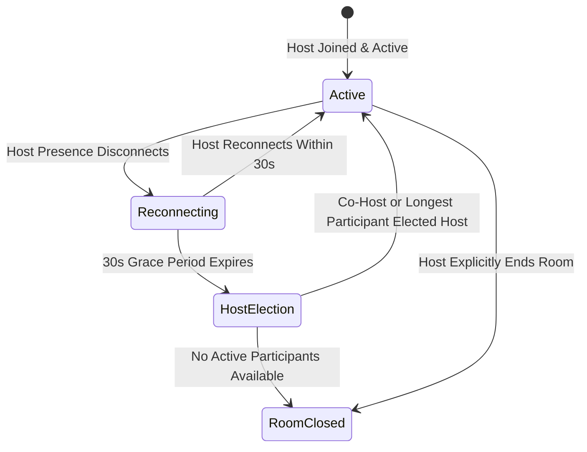

# Group Listening: Synchronized Playback Engine Specification 🎵⏱️

> **Document Status**: Production Architecture & Technical Specification
> **Sprint Scope**: Sprint 4.1
> **Target Module**: `src/hooks/useSession.ts`, `src/features/session/sessionSlice.ts`, `src/components/Player.tsx`

---

## 1. Playback Synchronization Strategy

In a synchronized room, the **Host** acts as the single source of truth for all playback parameters:
- `songId`: Current playing song identifier.
- `stateVersion`: Monotonically increasing counter incremented on every host state change (play, pause, seek, track change).
- `songPosition`: Millisecond timestamp where the track was when the broadcast was generated.
- `serverTimestamp`: Coordinated millisecond time when broadcast was dispatched.
- `playbackSpeed`: Host's selected rate (e.g., 1.0x).
- `isPlaying`: Boolean playback state.

### 1.1 Drift Estimation Formula
Upon receiving a heartbeat or state broadcast, the participant computes the estimated current host position:
$$\text{EstimatedHostPosition} = \text{broadcastPosition} + (\text{currentTime} - \text{broadcastTimestamp}) \times \text{playbackSpeed}$$
$$\text{Drift} = \left| \text{localAudioCurrentTime} - \text{EstimatedHostPosition} \right|$$

---

## 2. Tiered Drift Correction Architecture

To prevent aggressive, jarring seeks while keeping listeners in sync, correction is structured into three tiers:

| Drift ($\Delta t$) | Action Taken | Audio Impact | Duration |
|---|---|---|---|
| **$\Delta t < 1.5\text{s}$** | **No Correction** | None (natural network jitter) | Continuous |
| **$1.5\text{s} \le \Delta t \le 4.0\text{s}$** | **Micro Playback-Rate Adjustment** | Unnoticeable pitch-preserved tempo alignment | Clamped to max 8 seconds or until $\Delta t < 0.3\text{s}$ |
| **$\Delta t > 4.0\text{s}$** | **Controlled Seek** | Brief jump directly to host position | Single instant action |

### 2.1 Micro Playback-Rate Adjustment Implementation
- **Rate Multiplier**: If local client is lagging behind host, temporarily scale playback rate by **1.02x** ($\text{effectiveSpeed} = \text{userSpeed} \times 1.02$). If local client is ahead, scale by **0.98x** ($\text{effectiveSpeed} = \text{userSpeed} \times 0.98$).
- **Pitch Preservation**: Dual audio elements in `Player.tsx` enforce `preservesPitch = true`, preventing pitch alterations during micro-adjustments.
- **Speed Restoration**: Once drift drops below 0.3s or after 8 seconds of continuous micro-adjustment, audio rate reverts to the user's configured base playback speed.

---

## 3. Host Departure & Grace Period State Machine

1. **Host Presence Lost**:
   - If the host's Supabase presence leaves without an explicit `leave` broadcast, the room enters `status = 'reconnecting'` and starts a **30-second grace countdown**.
   - UI displays a subtle indicator: *"Host connection unstable, waiting up to 30s..."*.
2. **Host Reconnects**:
   - If the host returns within 30 seconds, host status is restored and an authoritative state broadcast resets participant clocks.
3. **Grace Expiration & Election**:
   - If 30 seconds elapse, an atomic database RPC `elect_next_room_host(room_id)` is invoked.
   - It checks for active `co-hosts` first (ordered by `joined_at`). If none exist, it promotes the longest-connected participant.
   - The promoted user's client receives confirmation, promotes its local Redux state to `isHost = true`, and resumes broadcasting.

---

## 4. Song Resolution & Failure Isolation

1. **Independent Provider Resolution**:
   - Each participant resolves the host's selected song through `MusicApiService` and their own local IndexedDB cache.
   - If a participant cannot resolve or stream the song (e.g. regional restrictions, rate limits):
     - The client displays an *"Unavailable in your region"* banner.
     - Local audio enters a silent pause state.
     - **Crucial**: The participant does not desynchronize from the room or disconnect. When the host switches to the next song, the participant automatically attempts resolution for the new track.
