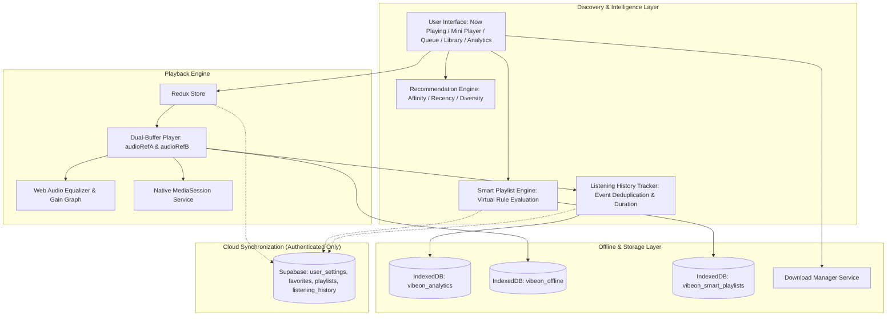

# Vibe On — Phase 3: Advanced Music Experience Architecture Document

> **Document Status**: Production Architecture & Technical Specification
> **Target Release**: Vibe On 1.1.0 (Capacitor Android versionCode 7+)
> **Scope**: Advanced Player, Intelligent Discovery, Smart Playlists, Listening Analytics, Audio Quality & Offline Hardening

---

## 1. Executive Summary & Existing Architecture Audit

Vibe On is a progressive web application and Capacitor-wrapped native Android client designed for music streaming, peer-to-peer audio/video collaboration, and offline playback.

### 1.1 Existing Functionality Audit
Prior to Phase 3, the codebase exhibits the following operational components:
1. **Dual-Buffer Audio Player (`src/components/Player.tsx`)**:
   - Manages two persistent HTML5 `<audio>` elements (`audioRefA`, `audioRefB`).
   - Gapless preloading triggers when the current track approaches completion.
   - Linear crossfade (1s–10s) adjusts volume attenuation between active and inactive buffers.
   - Storage resolution checks IndexedDB (`vibeon_offline`) before requesting remote CDN streams.
2. **State Management (`src/features/musicplayer/musicPlayerSlice.ts`, `src/features/library/librarySlice.ts`)**:
   - Redux Toolkit with `redux-persist` stores current playback song, playlist queue (capped at 100), recent tracks, download preferences, and equalizer presets.
3. **Music API Layer (`src/services/musicApiService.ts`)**:
   - Cascading requests between primary proxy (`elitejiosaavn-api.vercel.app`) and fallback proxy (`jiosaavn-api-cyan-theta.vercel.app`).
   - Circuit breaker (60s cooldown) and IndexedDB caching for API queries (`vibeon_music_cache_db`).
4. **Offline Persistence (`src/services/downloadManager.ts`, `src/utils/db.ts`)**:
   - Bounded concurrency queue (1–100 workers, default 3) storing raw audio blobs and cover art in `vibeon_offline` IndexedDB database.
5. **Portability Engine (`src/lib/portability/`)**:
   - Non-destructive library import and export across JSON v1, CSV (RFC 4180 with UTF-8 BOM), TXT, and M3U/M3U8.

### 1.2 Technical Debt & Architectural Gaps
- **Playback Rate / Speed Controls**: Missing from `Player.tsx` and `MobileNowPlaying.tsx`. Native HTML5 audio `playbackRate` needs unified management across both buffers without pitch distortion (`preservesPitch = true`).
- **Queue Controls**: Limited to basic reordering; lacking explicit "Play Next", "Add to Queue", track duplicate handling, and end-of-queue radio transitions.
- **Sleep Timer**: Only minute-based countdown without "End of Current Track" mode.
- **Lyrics Resilience**: `Lyrics.tsx` makes direct calls without a structured local cache or graceful plain/synced dual fallback.
- **Discovery & Personalization**: Recommendations currently rely on a single endpoint query (`/api/songs/:id/suggestions`) rather than multi-signal local client-side affinity scoring.
- **Playlists**: Static song arrays only. No dynamic virtual smart playlists (rule-based collections).
- **Listening History & Analytics**: History is locked to 20 unweighted rows in `listening_history` without play duration, completion percentage, or analytical summaries.
- **Offline / Storage**: No storage quota estimation or corrupted blob recovery.

---

## 2. Phase 3 Target Architecture

---

## 3. Sprint Execution Plan & Dependencies

### Sprint 3.1: Advanced Player Experience
- **Components**: `Player.tsx`, `MobileNowPlaying.tsx`, `Queue.tsx`, `SleepTimer.tsx`, `Lyrics.tsx`.
- **State Changes**: `musicPlayerSlice.ts` to add `playbackSpeed` (0.75x, 1.0x, 1.25x, 1.5x, 2.0x), `playNextInQueue`, and enhanced queue actions.
- **Lyrics Engine**: Caching layer with synced LRC parsing and plain-text fallback.
- **Acceptance Criteria**: Dual buffers maintain synchronized speed; queue reordering/removal functions seamlessly; sleep timer stops after current track or duration; lyrics render with auto-scroll.

### Sprint 3.2: Intelligent Music Discovery
- **Components**: `src/services/recommendationEngine.ts`, `Home.tsx`, `Explore.tsx`.
- **Logic**: Multi-factor scoring model combining artist affinity, genre affinity, recency, play count, and novelty penalties.
- **Documentation**: `docs/recommendation-engine.md`.
- **Acceptance Criteria**: Guest users get personalized sections based on local history; authenticated users sync preferences; recommendation dismissals persist.

### Sprint 3.3: Music Library & Playlist Intelligence
- **Components**: `src/services/smartPlaylistEngine.ts`, `Library.tsx`, `PlaylistPage.tsx`.
- **Logic**: Dynamic virtual smart playlists evaluating rules (`recently_played`, `most_played`, `favorites`, `artist`, `downloaded`), condition builders (AND/OR), and snapshot to static playlist.
- **History Tracking**: Event-driven history logger with playback progress thresholds (50% completion before recording a play) and playback-speed-adjusted listen time.
- **Acceptance Criteria**: Smart playlists re-evaluate instantly on library changes without duplicating song arrays.

### Sprint 3.4: Listening Analytics & Personal Insights
- **Components**: `src/pages/ListeningStats.tsx`, route `/stats`, links in `Profile.tsx` and `Library.tsx`.
- **Metrics**: Total listening minutes, track/artist play counts, time filters (7d, 30d, 90d, all-time), responsive trend charts.
- **Documentation**: `docs/listening-history-and-analytics.md`.
- **Acceptance Criteria**: Accurate calculations reflecting actual listen time and speed; responsive mobile/desktop layouts.

### Sprint 3.5: Audio Quality & Offline Experience
- **Components**: `Equalizer.tsx`, `downloadManager.ts`, `db.ts`, `SettingsDrawer.tsx`.
- **Enhancements**: Storage quota detection via `navigator.storage.estimate()`, corrupted download cleanup, quality fallback checks, offline mode UI states.
- **Documentation**: `docs/offline-and-downloads.md`, `docs/phase-3-testing.md`.
- **Acceptance Criteria**: Offline mode handles network drop gracefully; corrupted blobs are purged without affecting valid downloads.

---

## 4. Database Schema & Compatibility

Phase 3 requires **no destructive schema migrations**.
- Authenticated user preferences and smart playlist definitions are stored in existing JSONB structures:
  - `user_settings.settings.smart_playlists`: Array of smart playlist rule definitions.
  - `user_settings.settings.playback_speed`: Saved playback rate.
- Extended history records in local IndexedDB (`vibeon_analytics`) with optional cloud upsert to `listening_history` without breaking the `(user_id, song_id)` primary key constraint.
- Guest data resides entirely in browser IndexedDB and LocalStorage, guaranteeing 100% guest feature parity.

---

## 5. API Dependencies & Limitations

| Service / API | Purpose | Limitations & Mitigations |
|---|---|---|
| **LRCLIB (`https://lrclib.net/api/get`)** | Synced & unsynchronized lyrics | Rate limits & occasional missing regional tracks. Cached locally in IndexedDB/LocalStorage. Fallback to plain lyrics or informative empty state. |
| **JioSaavn Proxy API** | Song metadata, streaming URLs | Upstream CORS/rate-limits. Handled via `musicApiService` failover, exponential backoff, and 30-min cache. |
| **Navigator Storage API** | Quota calculation | `navigator.storage.estimate()` may not be available on all Android WebViews; guarded with fallback estimates. |

---

## 6. Risks and Compatibility Concerns
1. **Dual Audio Element Desynchronization**: Changing playback speed must apply to both `audioRefA` and `audioRefB` synchronously to prevent abrupt speed jumps on crossfade.
2. **AudioContext Autoplay Policies**: Web Audio equalizer node initialization must be tied to user gestures or deferred until user interaction.
3. **Virtual vs. Static Playlist Confusion**: Clear UI badges distinguish dynamic virtual "Smart Playlists" from user-curated static playlists, with a one-click "Snapshot to Static Playlist" option.
