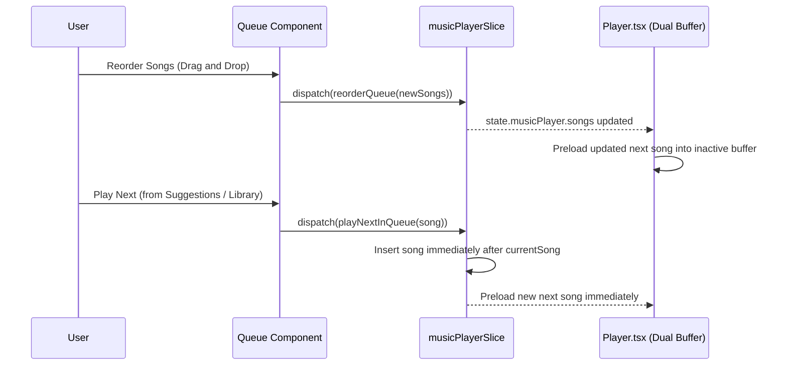

# Vibe On — Queue Management Architecture & Specification

> **Sprint Reference**: Sprint 3.1: Advanced Player Experience
> **Status**: Production Implementation

---

## 1. Overview & Data Flow

The queue management system in Vibe On coordinates current and upcoming tracks using Redux Toolkit (`src/features/musicplayer/musicPlayerSlice.ts`), visualized in `src/components/Queue.tsx` (slide-out drawer) and `src/components/MobileNowPlaying.tsx` (action sheet overlay).

---

## 2. Core Behaviors & Edge Cases

| Scenario | Defined Behavior | Implementation Location |
|---|---|---|
| **Play Next** | Places chosen track immediately after the currently playing song in `state.songs`, removing any existing duplicate instance first. | `playNextInQueue` reducer in `musicPlayerSlice.ts` |
| **Add to Queue** | Appends chosen track to the end of the queue if not already present. | `addToQueue` reducer in `musicPlayerSlice.ts` |
| **Reorder Queue** | Drag-and-drop using Framer Motion's `Reorder.Group` and `Reorder.Item`. Dispatches `reorderQueue` with full reordered list. | `Queue.tsx` |
| **Remove Currently Playing Track** | Removes the track; playback immediately advances to the next track in the queue, or stops if the queue is now empty. | Handled via `removeFromQueue` + `nextSong` |
| **End of Queue (Natural Completion)** | If `repeatMode === 'none'` and `isSongRadioEnabled`, autoplays similar song from recommendations; otherwise stops playback gracefully. | `Player.tsx:handleSongEnd` |
| **Sleep Timer "End of Track" Mode** | When `sleepTimerMode === 'endOfTrack'`, playback pauses as soon as the active song completes; sleep timer resets to null. | `Player.tsx:handleSongEnd` |
| **Playback Speed Transitions** | Preserves selected `playbackSpeed` (0.75x–2.0x) with pitch preservation enabled on both HTML5 audio elements across track transitions and crossfading. | `Player.tsx:useEffect([playbackSpeed])` |

---

## 3. Persistence & Hydration

- Queue songs (`songs`) are persisted across app restarts via `redux-persist` with `musicPlayer` slice in `localStorage`.
- Active playback progress is throttled to Redux state every 2 seconds and persisted on `beforeunload` or `visibilitychange: hidden`.
